# DIY Alerts & YCU Task Management: Comprehensive Product & Operational Walkthrough
> **Document ID:** YUMA-OPS-DIY-2026  
> **Status:** Approved / Production  
> **Target Audience:** Field Operations, YCS Technicians, L1/L2 Maintenance, Product, QA  
> **Standalone Interactive HTML:** [diy_alerts_confluence_walkthrough.html](file:///Users/vikakum4/.gemini/antigravity/brain/57a0cdbe-1b6b-4300-8a0e-8d8299a741bf/diy_alerts_confluence_walkthrough.html) *(Full-width layout with floating banners, animated flow arrows, lightbox zoom, and offline Base64 embedded images)*

---

## 1. Executive Summary & Architecture

The **DIY Alerts & Task Management** module (`feature/diy-alerts/task-management`) empowers on-ground field technicians to monitor, diagnose, and resolve issues across distributed **Yuma Charging Units (YCU)**. 
Built using **Jetpack Compose (Material3)**, **Kotlin Coroutines / Flow**, **Hilt**, and **Google Clean Architecture**, the feature provides continuous real-time station telemetry, GPS geo-fencing, pod status visualization (supporting 9-pod and 12-pod configurations), BMS diagnostics, and audit-compliant issue deflection and resolution workflows.

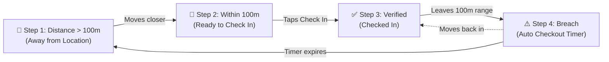

---

## 2. Complete Geofence Lifecycle: 4 Sequential States

Technicians are strictly required to be physically present at the station site. The app calculates real-time distance using Haversine calculation against the station's assigned radius (`taskDetail.radius`, default ~100 meters).

| Step | State | UI Display | User Action | Backend Trigger |
| :---: | :--- | :--- | :--- | :--- |
| **1** | **Away from Location** | Disabled outlined button with prohibition icon `⊘` | Cannot check in or resolve issues. Must move closer to station. | `distanceInMeters > radius` |
| **2** | **Within Range (Ready)** | Solid black primary "Check In" button enabled with location pin | Tap "Check In" to send GPS coordinates to backend. | `distanceInMeters <= radius && !isCheckedIn` |
| **3** | **Checked In** | Solid green button (`#059669`) with location icon | Access all diagnostics, pod unlocks, and issue resolutions. | `isCheckedIn == true` |
| **4** | **Out-of-Range Breach** | Red sticky card with animated countdown progress: *"Seems like you're out of location range. Checking out in X secs..."* | Move back inside 100m within countdown or session terminates. | `isLocationCheckoutRunning == true` |

### Step-by-Step Exhibit with Flow Progression:

````carousel
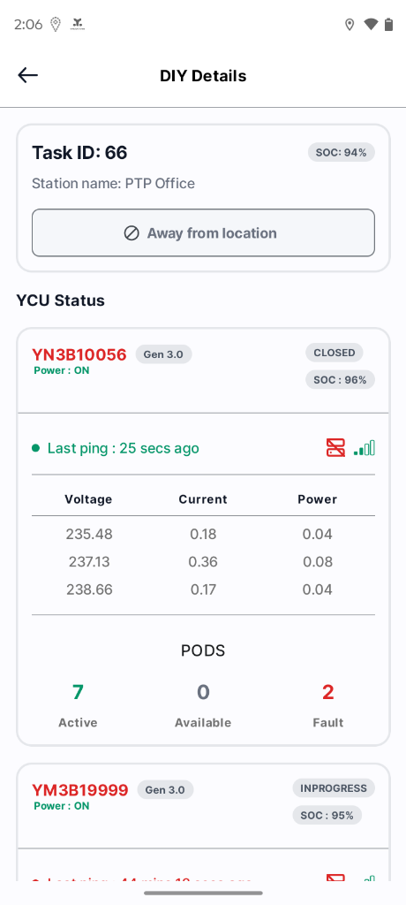
<!-- slide -->
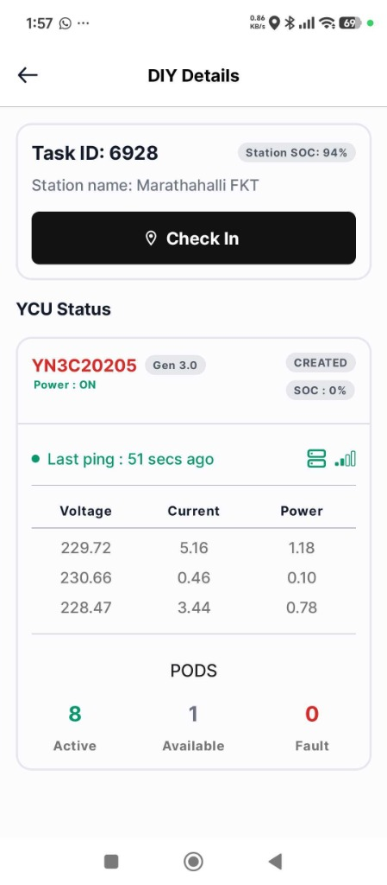
<!-- slide -->
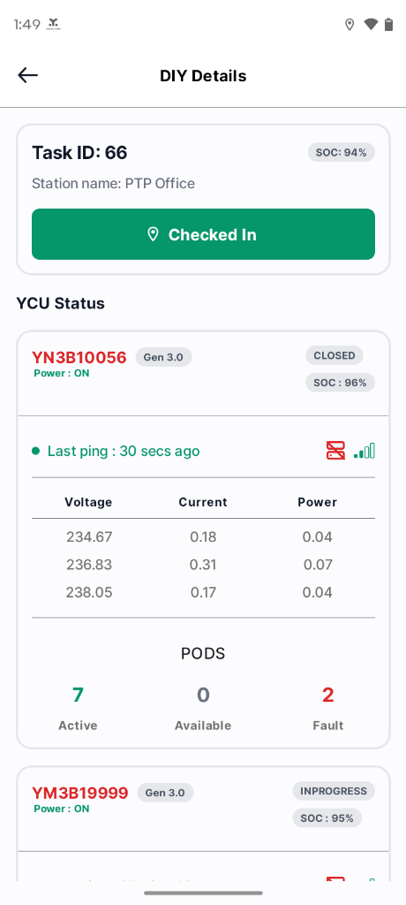
<!-- slide -->
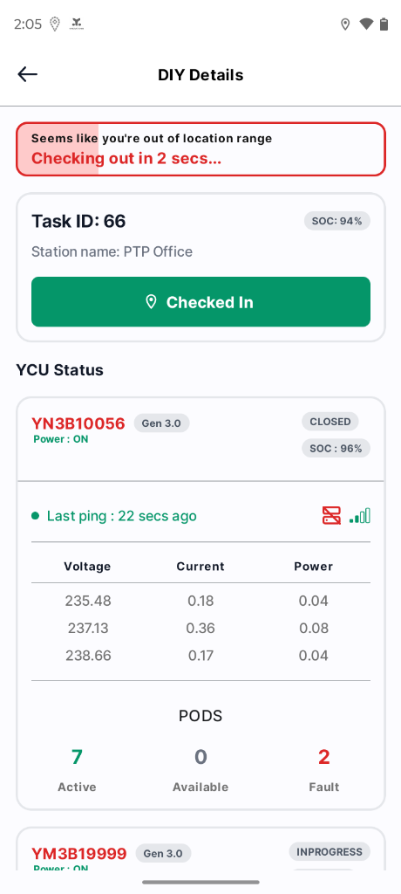
````

* **Figure 2.1:** `Step 1: Distance > 100m` ➔ Disabled "Away from location" state.
* **Figure 2.2:** `Step 2: Distance ≤ 100m` ➔ Active black "Check In" button enabled at Marathahalli FKT.
* **Figure 2.3:** `Step 3: Verified Check-in` ➔ Solid green "Checked In" status at PTP Office.
* **Figure 2.4:** `Step 4: Boundary Breach` ➔ Auto-checkout timer with animated pink progress fill.

---

## 3. Station Telemetry & 3-Phase Power Monitoring

Every station card displays real-time health:
- **Station Meta:** Task ID (e.g. *Task ID: 6928*), Station SOC % (*94%*), Station Name (*Marathahalli FKT* / *PTP Office*).
- **YCU Header:** QR Code (*YN3C20205*, *YN3B10056*), Hardware Generation (*Gen 3.0*), Health status (red if unhealthy), Power State (*Power: ON / OFF*), and Issue Lifecycle (*CREATED*, *INPROGRESS*, *RESOLVED*, *CLOSED*).
- **Heartbeat & Signal:** Last ping counter (e.g., *Last ping: 51 secs ago*), station rack icon, and green signal meter.
- **3-Phase Electrical Meter:**
  - **Phase 1 (R):** 229.72 V | 5.16 A | 1.18 kW
  - **Phase 2 (Y):** 230.66 V | 0.46 A | 0.10 kW
  - **Phase 3 (B):** 228.47 V | 3.44 A | 0.78 kW
- **Pod Summary:** 8 Active | 1 Available | 0 Fault.

---

## 4. Station "Other Issues" Resolution

For non-pod defects (cabin damage, testing bypasses, AC fluctuation):
1. **Selection:** Check the checkbox next to the target issue (e.g. `yuma 1`).
2. **Comment Entry:** Expands an inline comment input (max 120 chars, e.g. `0/120`). Submitting an empty note prompts: *"please tell us how you resolved this."*
3. **Resolution:** Tap the black "Resolve issue" button with checkmark icon (requires technician to be Checked In).

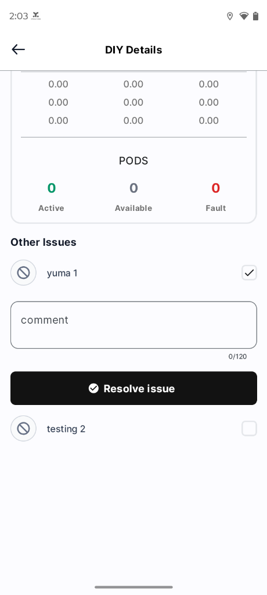
*Figure 4.1: Other Issues inline comment form and resolution trigger*

---

## 5. Pod Matrix & Status Colors

Stations dynamically display a 3-column grid for **9 Pods** or **12 Pods**:

| Status | Container BG | Content Color | Icon | Description / Trigger |
| :--- | :--- | :--- | :--- | :--- |
| **CHARGED** | `#ECFDF5` (Mint Green) | `#059669` (Dark Green) | 🔒 Lock / ⚠️ Alert | Fully charged battery ready for swap (`chargeState == "Charged"`). |
| **CHARGING** | `#E8F0FA` (Soft Blue) | `#156CCF` (Blue) | 🔒 Lock | Battery currently charging (`chargeState == "Charging"`). |
| **POD FAULTY** | `#FEF2F2` (Soft Red) | `#B91C1C` (Dark Red) | ⚠️ Warning Triangle | Pod hardware or latch error (`isPodFaulty == true`). |
| **POD FROZEN** | `#FEFCE8` (Light Yellow) | `#A16207` (Olive Amber) | 🔒 Lock / ⊘ Blocked | Pod locked in frozen state (`isPodFrozen == true`). |
| **BATTERY BIN ISSUE** | `#FFF7ED` (Soft Orange) | `#EA580C` (Orange) | 🔒 Lock / ⊘ Blocked | BMS communication failure, displays `255%` code. |
| **NO BATTERY** | `#FFFFFF` (White) | `#98A2B3` (Grey) | 🔒 Lock | Empty slot with dashed dark border (`#111827`). |

````carousel
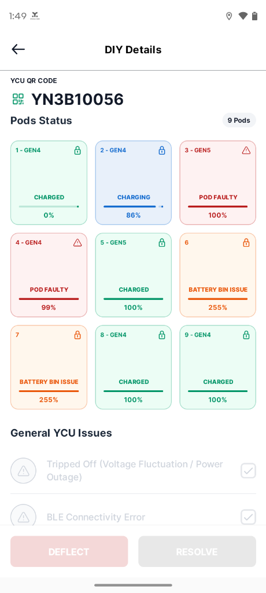
<!-- slide -->
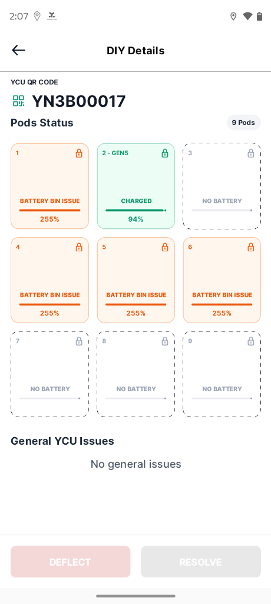
<!-- slide -->
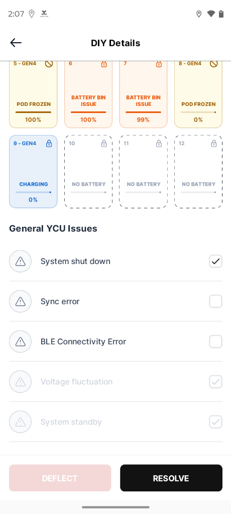
````

---

## 6. Pod & Battery Diagnostics

Tapping any pod card opens the **Pod Diagnostics Bottom Sheet**:

### Tab 1: Pod Issues
Displays pod-specific alerts (e.g. *"Battery not charging"*, lock stuck). Technicians select checkable issues for resolution.

### Tab 2: Battery Diagnostics (14 BMS Telemetry Parameters)
- **Charge State:** *Charged* (Blue highlight)
- **QR Code:** *ET077355*
- **Battery Temperature:** *27.25 °C* (Thermal check)
- **Battery Generation:** *GEN 4* / *GEN 5*
- **SOC:** *99 %* (Green highlight)
- **Health (SOH):** *98 %*
- **SOE, Charge Cycles, Available Energy, Capacity, Location Status ID, Time to Charge, Charging Error, Battery Faulty**.

````carousel
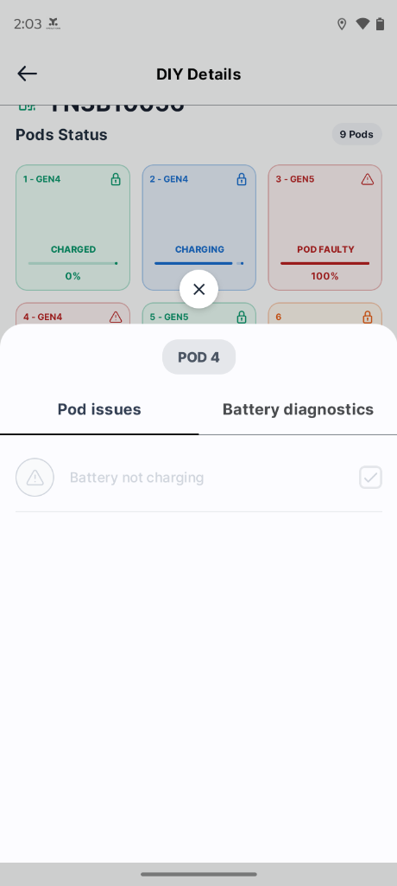
<!-- slide -->
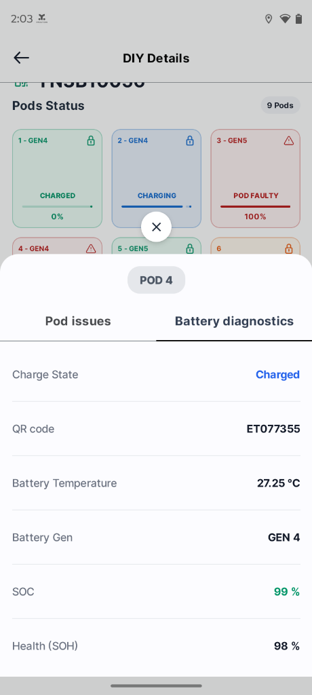
````

---

## 7. Resolution & Deflection SOP

At the bottom of the Pod Details Screen:
- **DEFLECT (Red `#DC2626`):** Active only if an issue is selected AND `toDeflect == true`. Used to escalate unresolvable physical faults (burned PCB, mechanical failure) to L2 maintenance.
- **RESOLVE (Black `#000000`):** Active whenever an issue is selected. Submits resolution and clears the alert on the IoT cloud.


*Figure 7.1: Real-time station execution*

---

## 8. Interactive Standalone HTML Document

A fully self-contained HTML document with a clean single-column layout, floating callouts, animated directional arrows, and zero external image dependencies is available at:  
👉 **[diy_alerts_confluence_walkthrough.html](file:///Users/vikakum4/.gemini/antigravity/brain/57a0cdbe-1b6b-4300-8a0e-8d8299a741bf/diy_alerts_confluence_walkthrough.html)**
